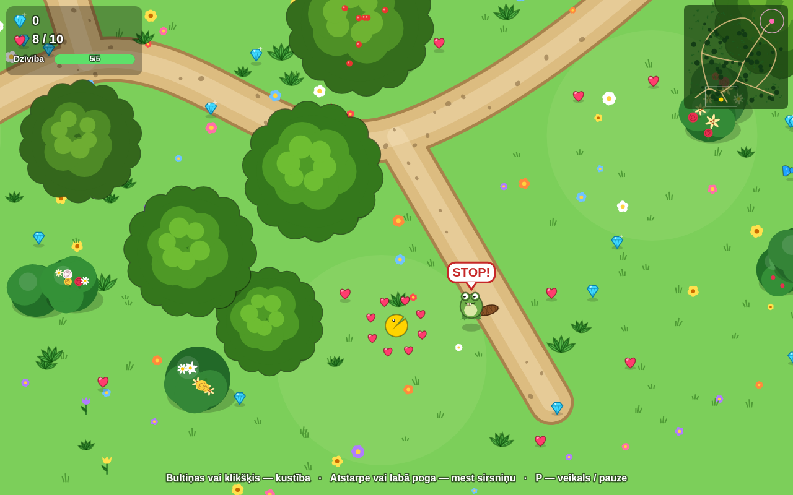

# Sirsiņbumba / Heart Ball

A top-view, scrollable browser game. A round one-eyed creature collects hearts, which orbit it as a
ball and work as both armour and ammo, gathers diamonds to buy new colours, and fights a flower boss.
All in-game text is in Latvian.

## Run

Open `index.html` in a browser, or serve the directory with `python3 -m http.server 8000`. There are
no dependencies or build step, and all art is drawn in code.

## Controls

Arrows or click to move · Space or right click: throw a heart · P: shop / pause · Enter: start,
buy or choose.
